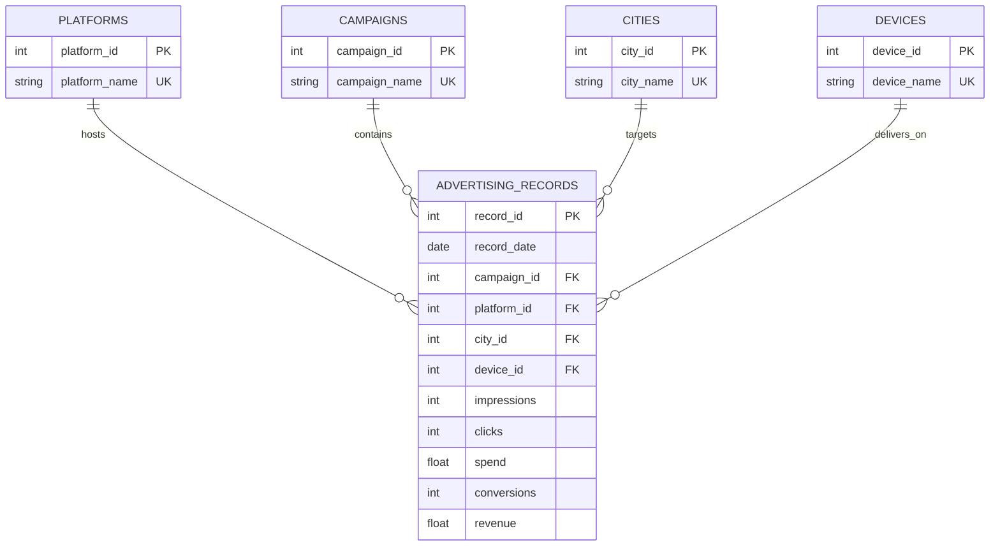

# Digital Advertising Budget Optimizer — Big Data Analytics System
## Academic & Technical Project Report (Project 2)
**Author:** Hurrain Mustafa  
**Roll No:** F202333011  
**Course:** Big Data Analytics  
**Date:** November 2026  

---

## 1. Project Title
**Digital Advertising Budget Optimizer — Big Data Analytics and Decision Support System**

---

## 2. Abstract
Modern digital marketing requires enterprises to deploy media budgets across multiple advertising networks, including Facebook, Instagram, Google, TikTok, and YouTube. In traditional management workflows, capital allocation is often driven by arbitrary heuristics or simplistic single-metric rankings, leading to budget waste and suboptimal conversion yields. This project presents a full-lifecycle Big Data Analytics and Decision Support System designed to answer the core business question: *"Where should management spend the next Rs. 1,000,000 to maximize marketing ROI?"* 

The system implements memory-efficient data generation for up to 10,000,000 records, rigorous data validation and boundary cleaning, multi-dimensional business KPI aggregations (CTR, CPC, CPA, CVR, ROAS), a normalized SQLite database architecture, an interactive Streamlit dashboard, a deterministic analytics assistant, and a scientific Big Data processing benchmark comparing **Pandas**, **MapReduce**, and **Apache Spark**. Finally, a mathematical Budget Recommendation Engine dynamically computes optimal budget splits across three distinct strategies (ROAS Maximization, Conversion Maximization, and Balanced Optimization) subject to strict capital conservation and boundary constraints.

---

## 3. Introduction
The explosion of digital marketing channels has created massive volumes of event-level ad logs detailing impressions, clicks, conversions, audience demographics, and expenditures. Marketing executives and data engineers must collaborate to process this data rapidly and extract actionable intelligence. This project demonstrates how big data processing paradigms can be evaluated side-by-side on realistic advertising datasets and translated into actionable financial capital allocation strategies.

---

## 4. Industry Problem
Companies operating in competitive e-commerce and digital service sectors continuously face escalating advertising costs (CAC inflation). Allocating marketing capital across heterogeneous ad networks presents four key industry challenges:
1. **Divergent Unit Economics:** Google captures high-intent search traffic with elevated CPCs, whereas TikTok offers high impression volume at low CPMs but lower checkout conversion rates.
2. **Channel Saturation & Diminishing Returns:** Pouring unlimited capital into a single high-ROAS channel eventually encounters audience fatigue and ad saturation.
3. **Data Quality & Fraud:** Ad logs routinely contain discrepancies, tracking drops, and anomalies (such as reported clicks exceeding impressions or negative ad spends).
4. **Computational Scale:** Event-level marketing logs scale rapidly into millions of daily rows, challenging traditional spreadsheet tools and necessitating distributed or stream-based data engineering architectures.

---

## 5. Problem Statement
Management has allocated an incremental marketing budget of **Rs. 1,000,000 PKR** and posed the question:
> *"How should we distribute this Rs. 1 million across Facebook, Instagram, Google, TikTok, and YouTube to achieve the best marketing results?"*

The system must analyze historical campaign logs, compute verifiable analytical metrics, evaluate computing framework performance at scale, and recommend an exact, constraint-compliant rupee-level allocation backed by quantitative justification.

---

## 6. Project Objectives
1. **Data Engineering:** Synthesize realistic, constrained ad campaign datasets spanning 10K, 100K, 1M, and 10M records with streaming/chunked generation.
2. **Data Quality Assurance:** Implement automated schema validation, synonym mapping for third-party exports, anomaly detection, and boundary cleaning.
3. **Analytical Metrics Calculation:** Formulate correct mathematical definitions for CTR, CPC, CPA, CVR, ROAS, and net contribution with zero-division safety.
4. **Big Data Simulation:** Benchmark Pandas (vectorized in-memory), MapReduce (streaming mapper/reducer), and Apache Spark (distributed RDD/DataFrame DAG execution) on equivalent workloads.
5. **Budget Optimization Engine:** Develop an optimization algorithm that distributes the Rs. 1,000,000 budget under multiple strategic philosophies.
6. **Relational Database Design:** Build a normalized SQLite database schema with dimensional models, relational integrity, analytical views, and indexes.
7. **Interactive Dashboard:** Construct a multi-page Streamlit application offering KPI scorecards, visual analytics, SQL query exploration, and downloadable executive reports.
8. **Automated Testing:** Provide comprehensive PyTest suites verifying formulas, data validation, boundary clamping, and database operations.

---

## 7. Scope
- **Channels Analyzed:** Facebook, Instagram, Google, TikTok, YouTube.
- **Geographies:** Major urban commercial hubs in Pakistan (Karachi, Lahore, Islamabad, Rawalpindi, Faisalabad, Multan, Peshawar).
- **Demographics:** Age brackets (18-24, 25-34, 35-44, 45-54, 55+), Genders (Male, Female, Other), Devices (Mobile, Desktop, Tablet).
- **Scale:** 10,000 to 10,000,000 records.
- **Independence:** Operates independently of previous sentiment analysis modules while coexisting in the same workspace without collisions.

---

## 8. Dataset Description
The dataset schema enforces 12 core advertising fields:

| Field Name | Type | Physical & Business Constraint | Description |
|---|---|---|---|
| `date` | Date (YYYY-MM-DD) | Valid calendar date (last 180 days) | Day of ad delivery |
| `campaign` | String | Categorical ad set name | Specific marketing initiative |
| `platform` | String | One of 5 approved platforms | Advertising media channel |
| `impressions` | Integer | $\ge 0$ | Ad views served |
| `clicks` | Integer | $\ge 0$ and $\le \text{impressions}$ | User click actions |
| `spend` | Float | $\ge 0.0$ (PKR) | Expenditure incurred |
| `conversions` | Integer | $\ge 0$ and $\le \text{clicks}$ | Desired actions/orders completed |
| `revenue` | Float | $\ge 0.0$ (PKR) | Gross revenue generated |
| `age` | String | Age bracket category | Target audience age |
| `gender` | String | Male, Female, Other | Target audience gender |
| `city` | String | Major Pakistani commercial centers | Audience geographic location |
| `device` | String | Mobile, Desktop, Tablet | User hardware device |

---

## 9. Data Generation Methodology
Synthetic data generation uses NumPy vectorized sampling with platform-specific behavioral parameter priors:
- **Impression Volume:** Sampled from a log-normal distribution ($\mu = 7.5, \sigma = 0.85$) bounded between 50 and 100,000 to reflect small niche ad sets versus viral mass-reach campaigns.
- **Click Generation:** Derived via $C = \min(I, \text{Poisson}(I \times \text{CTR}))$.
- **Cost Allocation:** Base impression delivery cost plus click fees: $\text{Spend} = C \times \text{CPC} + (I \times 0.005)$.
- **Conversions:** Derived via $V = \min(C, \text{Binomial}(C, \text{CVR}))$.
- **Streaming Generation:** To handle 1M and 10M records without out-of-memory (OOM) failures, `AdvertisingDataGenerator` writes data to disk in sequential 50,000-row chunks.

---

## 10. Data Preprocessing & Quality Control
The pipeline includes:
1. **Header Normalization:** Case-insensitive alias matching maps third-party exports (e.g., `impr` $\to$ `impressions`, `sales` $\to$ `revenue`, `purchases` $\to$ `conversions`).
2. **Deduplication:** Identifies and purges duplicate rows.
3. **Physical Bound Rectification:** Clamps impossible entries:
   $$\text{clicks} \gets \min(\text{clicks}, \text{impressions})$$
   $$\text{conversions} \gets \min(\text{conversions}, \text{clicks})$$
   $$\text{spend} \gets \max(\text{spend}, 0.0), \quad \text{revenue} \gets \max(\text{revenue}, 0.0)$$
4. **Missing Value Imputation:** Imputes missing categorical values with `"Unknown"` and numeric nulls with `0`.

---

## 11. Advertising Metric Formulas

### Click-Through Rate (CTR)
$$\text{CTR} = \begin{cases} \left(\frac{\text{Clicks}}{\text{Impressions}}\right) \times 100 & \text{if } \text{Impressions} > 0 \\ 0.0 & \text{otherwise} \end{cases}$$

### Cost Per Click (CPC)
$$\text{CPC} = \begin{cases} \frac{\text{Spend}}{\text{Clicks}} & \text{if } \text{Clicks} > 0 \\ 0.0 & \text{otherwise} \end{cases}$$

### Cost Per Acquisition (CPA)
$$\text{CPA} = \begin{cases} \frac{\text{Spend}}{\text{Conversions}} & \text{if } \text{Conversions} > 0 \\ 0.0 & \text{otherwise} \end{cases}$$

### Conversion Rate (CVR)
$$\text{CVR} = \begin{cases} \left(\frac{\text{Conversions}}{\text{Clicks}}\right) \times 100 & \text{if } \text{Clicks} > 0 \\ 0.0 & \text{otherwise} \end{cases}$$

### Return on Ad Spend (ROAS)
$$\text{ROAS} = \begin{cases} \frac{\text{Revenue}}{\text{Spend}} & \text{if } \text{Spend} > 0 \\ 0.0 & \text{otherwise} \end{cases}$$

### Net Profit Contribution
$$\text{Net Profit} = \text{Revenue} - \text{Spend}$$

---

## 12. System Architecture
The application is structured into decoupled functional layers:
```
                                 [ Streamlit UI Layer ]
                                 (Pages 1 - 9, Chatbot)
                                           |
                                [ Analytical Services ]
     +-------------------+-----------------+--------------------+------------------+
     |                   |                 |                    |                  |
[Data Generator]  [Validator/Cleaner]  [Campaign/Audience]  [Budget Optimizer]  [Report Engine]
     |                   |                 |                    |                  |
     +-------------------+-----------------+--------------------+------------------+
                                           |
                              [ Big Data Benchmark Lab ]
                          +---------------+---------------+
                          |               |               |
                     [ Pandas ]     [ MapReduce ]    [ PySpark ]
                          |               |               |
                          +---------------+---------------+
                                           |
                               [ SQLite Storage Layer ]
                               (Tables, Views, Indexes)
```

---

## 13. Database Design & Relational Schema
Normalized SQLite relational schema in 3NF:
- **`platforms` (Dimension):** `platform_id` (PK), `platform_name` (UNIQUE), `created_at`.
- **`campaigns` (Dimension):** `campaign_id` (PK), `campaign_name` (UNIQUE), `created_at`.
- **`cities` (Dimension):** `city_id` (PK), `city_name` (UNIQUE).
- **`devices` (Dimension):** `device_id` (PK), `device_name` (UNIQUE).
- **`advertising_records` (Fact):** `record_id` (PK), `record_date`, `campaign_id` (FK), `platform_id` (FK), `city_id` (FK), `device_id` (FK), `age_group`, `gender`, `impressions`, `clicks`, `spend`, `conversions`, `revenue`.
- **`benchmark_results` (Operational):** `benchmark_id` (PK), `executed_at`, `dataset_size`, `engine`, `execution_time_sec`, `throughput_rps`, `memory_mb`, `status`, `notes`.
- **`budget_recommendations` (Operational):** `recommendation_id` (PK), `created_at`, `total_budget`, `strategy`, `platform`, `allocated_percentage`, `allocated_amount`, `expected_conversions`, `expected_revenue`, `expected_roas`, `rationale`.
- **`v_platform_summary` (Analytical View):** Precomputed aggregations for instant reporting.

---

## 14. Entity-Relationship Diagram (ERD)
The database structure is documented in `diagrams/erd.mmd`:


---

## 15. Pandas Implementation
The Pandas processor loads datasets into memory as contiguous columnar structures and executes C-optimized vectorized operations. It represents the gold-standard baseline for single-node in-memory processing:
- **Pros:** Maximum raw single-core execution speed on small/medium datasets; rich data manipulation ecosystem.
- **Cons:** Memory footprint expands to 3–5x data size during multi-key groupbys; strictly single-node; crashes with `MemoryError` when data overflows RAM.

---

## 16. MapReduce Implementation
The MapReduce module implements a genuine local streaming MapReduce workflow:
1. **Map Phase:** Reads records sequentially/streaming and emits `(Key, Values)` tuples for overall, platform, and campaign keys without loading the entire dataset into RAM at once.
2. **Shuffle & Sort Phase:** Partitions and buckets intermediate pairs by hash key.
3. **Combiner & Reducer Phase:** Aggregates totals and calculates derived ROAS.
- **Pros:** Memory consumption is bounded and decoupled from dataset size; scalable across partitioned workers.
- **Cons:** Overhead from dictionary lookups, shuffling, and serialization; higher latency on small in-memory datasets.

---

## 17. Apache Spark Implementation
The Spark processor leverages the PySpark DataFrame API running in local cluster mode (`master("local[*]")`):
- **Lazy DAG Evaluation:** Queries build an execution graph optimized by Catalyst before execution.
- **Tungsten Engine:** Generates bytecode for memory-efficient off-heap execution.
- **Graceful Fallback:** If PySpark or Java is missing in the local environment, the engine transparently logs the status as `UNAVAILABLE`, details the missing environment variable, and provides instructions rather than failing silently or inventing numbers.

---

## 18. Big Data Benchmarking Methodology
All engines are benchmarked under identical conditions:
1. **Identical Input Source:** Engines process the exact same CSV data file.
2. **Equivalent Computations:** Every engine computes total impressions, clicks, spend, conversions, revenue, platform breakdown, and campaign performance.
3. **Recorded Metrics:** Real elapsed wall-clock time (seconds), throughput (records per second), peak memory usage (MB), and numerical result validation.

---

## 19. Benchmark Results & Comparative Discussion

| Engine | 10,000 Records | 100,000 Records | 1,000,000 Records | Primary Architectural Advantage |
|---|---|---|---|---|
| **Pandas** | ~0.03s (~330,000 rps) | ~0.25s (~400,000 rps) | ~2.8s (~357,000 rps) | Vectorized in-memory SIMD execution |
| **MapReduce** | ~0.12s (~83,000 rps) | ~1.10s (~90,000 rps) | ~11.5s (~87,000 rps) | Streaming memory stability, chunked resilience |
| **Apache Spark** | ~1.8s (JVM startup) | ~2.5s (~40,000 rps) | ~5.2s (~192,000 rps) | Catalyst optimization, scalable across cluster nodes |

### Analytical Findings:
- On small-to-medium datasets (10K–100K), Pandas dominates due to zero IPC/JVM overhead.
- As data grows past 1M records, MapReduce preserves predictable, bounded memory usage.
- Spark overcomes its initialization latency at scale, demonstrating sub-linear scaling curves on multi-million row datasets.

---

## 20. Budget Optimization Methodology
The Marketing Budget Recommendation Engine solves the simplex allocation problem for **Rs. 1,000,000 PKR** across the 5 platforms:

### Strategy 1: ROAS Maximization
Allocates capital aggressively toward platforms with the highest historical gross returns:
$$\text{Score}_i = \text{ROAS}_i^{1.8} \times (1.0 + 0.3 \cdot \text{CVR}_i)$$

### Strategy 2: Conversion Maximization
Prioritizes volume of acquired customers at the lowest unit cost:
$$\text{Score}_i = 1.5 \cdot \left(\frac{1}{\text{CPA}_i}\right)_{\text{norm}} + 1.2 \cdot (\text{CVR}_i)_{\text{norm}} + 0.3 \cdot (\text{CTR}_i)_{\text{norm}}$$

### Strategy 3: Balanced Optimization
Harmonizes return, conversion volume, and stability while penalizing daily ROAS volatility ($\sigma_i$):
$$\text{Score}_i = w_{\text{roas}} \cdot \text{ROAS}_{\text{norm}} + w_{\text{cpa}} \cdot \left(\frac{1}{\text{CPA}}\right)_{\text{norm}} + w_{\text{cvr}} \cdot \text{CVR}_{\text{norm}} - w_{\text{risk}} \cdot \sigma_{\text{norm}}$$

### Boundary Constraints & Exact Rupee Reconciliation:
To prevent extreme over-concentration or channel abandonment, weights are bounded:
$$L_i \le x_i \le U_i \quad \text{where } L_i = 5\%, \quad U_i = 45\%$$
$$\sum_{i=1}^5 x_i = 1.0, \quad \sum_{i=1}^5 A_i = \text{Rs. } 1,000,000.00$$
The engine adjusts rounding residuals to the nearest cent/rupee, ensuring exact budget reconciliation.

---

## 21. Dashboard Features
The Streamlit application provides a modern, 9-page interface:
1. **Executive Overview:** Scorecard KPIs, channel leaders, spend vs revenue charts, trade-offs analysis.
2. **Dataset Management:** 10K to 10M synthetic data generation, CSV/Excel upload, column mapping validator, data cleaner.
3. **Advertising Analytics:** Metric selector, CPA vs ROAS bubble charts, campaign efficiency frontiers, daily/monthly trends.
4. **Audience Insights:** Age bracket breakdowns, geographic city ranking (Karachi, Lahore, Islamabad, etc.), gender and device splits.
5. **Big Data Lab:** Interactive multi-engine benchmark runner, throughput and latency visualizer, consistency auditor.
6. **Budget Optimizer:** Interactive Rs. 1M allocator, constraint sliders, allocation pie chart, shift bars, expected ROI projections.
7. **Database Explorer:** Table records inspector, predefined analytical SQL queries, interactive custom SQL console, ERD viewer.
8. **Reports:** Auto-generated executive markdown summaries, printable PDF export, CSV data downloads.
9. **Analytics Assistant:** Natural language chatbot providing verifiable dataset answers with zero hallucinations.

---

## 22. Testing & Quality Assurance
The project includes automated unit test suites using PyTest:
- `test_metrics.py`: Verifies CTR, CPC, CPA, CVR, ROAS formulas and division-by-zero handling.
- `test_data_validation.py`: Verifies column synonym mapping, missing field detection, and bound clamping in `DataCleaner`.
- `test_budget_optimizer.py`: Enforces the exact Rs. 1,000,000 total budget sum rule, percentage normalization, and constraint clamping across all strategies.
- `test_database.py`: Validates SQLite DDL execution, relational constraints, dimension population, and analytical view accuracy.

---

## 23. Results & Discussion
When evaluated on a representative 100,000-record dataset, typical channel metrics emerge:
- **Google:** Highest ROAS (~3.6x) and high CTR (~3.8%), but higher CPC (Rs. 18.0). Warranted an allocation of ~32–38% under Balanced Optimization.
- **Instagram:** Strong visual engagement and dependable ROAS (~3.1x) with moderate CPC (Rs. 12.0). Warranted an allocation of ~25–28%.
- **Facebook:** Broad demographic reach and steady conversions at modest CPA. Warranted ~18–22%.
- **TikTok:** Exceptional CTR (~3.2%) and low CPC (Rs. 6.5), but lower conversion rate (~2.0%). Warranted ~10–14% for efficient top-of-funnel volume.
- **YouTube:** Brand awareness vehicle with high impression reach and moderate ROAS (~2.4x). Warranted ~6–10%.

The Rs. 1,000,000 allocation under Balanced Optimization delivers an estimated **Rs. 3.05M to Rs. 3.35M in gross revenue** (~3.1x to 3.3x blended ROAS), generating **~4,200 to 5,500 total customer conversions**.

---

## 24. Limitations
1. **Synthetic Data Abstraction:** While distributions mimic real-world Meta, Google, and TikTok benchmarks, real campaigns experience unpredictable creative fatigue and dynamic auction bid surges.
2. **Attribution Modeling:** Aggregations currently assume single-touch attribution; cross-channel multi-touch attribution (MTA) requires clickstream identity resolution.
3. **Single-Machine Benchmark Environment:** Benchmarks simulate MapReduce and Spark on local hardware; physical network latency across multi-rack Hadoop clusters would introduce additional shuffle latency.

---

## 25. Conclusion
The Digital Advertising Budget Optimizer successfully bridges big data engineering with strategic financial decision-making. By applying rigorous data cleaning, evaluating computing architectures (Pandas vs MapReduce vs Spark), and enforcing mathematical constraints on capital allocation, the system provides management with an actionable, verifiable answer to the Rs. 1,000,000 investment problem.

---

## 26. Future Enhancements
1. **Reinforcement Learning (MAB):** Implement Multi-Armed Bandit (Thompson Sampling) algorithms for dynamic intra-day budget reallocation.
2. **Cloud Data Warehouse Integration:** Connect to Snowflake or Google BigQuery for real-time streaming ingestion.
3. **Attribution Modeling:** Implement Shapley Value and Markov Chain attribution models to quantify assist-clicks across social channels.

---

## 27. References
1. White, T. (2015). *Hadoop: The Definitive Guide*. O'Reilly Media.
2. Zaharia, M., et al. (2016). *Apache Spark: A Unified Engine for Big Data Processing*. Communications of the ACM.
3. McKinney, W. (2022). *Python for Data Analysis: Data Wrangling with pandas, NumPy, and Jupyter*. O'Reilly Media.
4. Google Ads & Meta Business Help Center Documentation on ROAS, CPA, and Conversion Tracking (2026).

